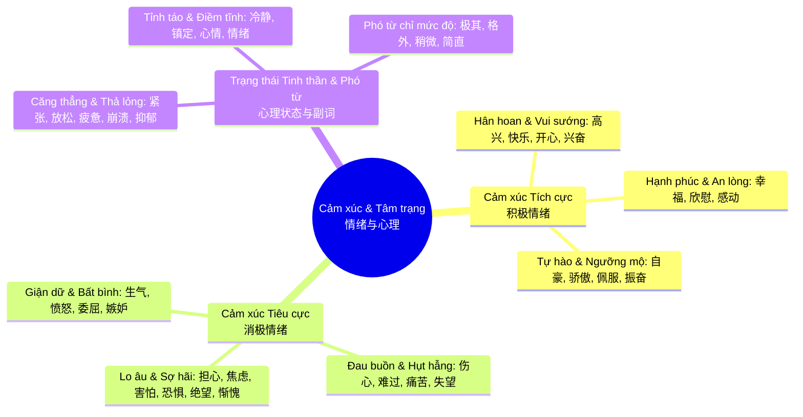

# 4. Cảm xúc, Tâm trạng & Trạng thái tinh thần (情绪与心理)

> **Mã chủ đề**: `4.md` / `4-cam-xuc-tam-trang-va-trang-thai-tinh-than.md`  
> **Thuộc Đại mảng 1**: Con người, Gia đình & Cảm xúc cá nhân  
> **Tên Hán tự**: 情绪与心理 / Qíngxù yǔ xīnlǐ / Tình tự dữ tâm lý  

---

## MỤC 1: TỔNG QUAN CHỦ ĐỀ & HỆ THỐNG BỘ THỦ CỐT LÕI

### 1.1. Giới thiệu chủ đề
Trong đời sống ngôn ngữ, khả năng bộc lộ và mô tả các cung bậc cảm xúc, thế giới nội tâm và trạng thái tinh thần là thước đo chuẩn xác cho sự tinh tế và chiều sâu giao tiếp của một người học tiếng Trung. Cảm xúc con người không chỉ đơn thuần là "vui" (`高兴`) hay "buồn" (`难过`), mà là một dải quang phổ biến ảo khôn lường từ hồi hộp, âu lo, phẫn uất, tủi thân đến bình yên, tự hào và vỡ òa hạnh phúc. 

Người Trung Quốc từ xưa đã quan niệm "Tâm thân hợp nhất" (心身合一) – cảm xúc trong tâm can luôn gắn liền mật thiết với phản ứng của cơ thể và ngũ tạng. Nắm vững hệ thống từ vựng về cảm xúc cùng các phó từ chỉ mức độ giúp người học không chỉ diễn đạt chính xác trạng thái của bản thân mà còn thấu cảm sâu sắc nỗi lòng của người khác.

### 1.2. Bản đồ phân nhánh từ vựng (Sub-categories)
1. **Cảm xúc tích cực & Hân hoan (积极情绪与欣喜)**: Niềm vui, sự hạnh phúc, lòng tự hào, cảm giác xúc động, phấn chấn và mong đợi tương lai.
2. **Cảm xúc tiêu cực, Lo âu & Đau buồn (消极情绪、焦虑与悲伤)**: Cơn thịnh nộ, sự giận dỗi, tủi thân, lo lắng thắt lòng, nỗi buồn tan vỡ, cô độc và tuyệt vọng.
3. **Trạng thái tinh thần, Tâm lý & Phó từ mức độ (心理状态与情绪副词)**: Trạng thái căng thẳng, suy sụp, bình tĩnh, buông lỏng nội tâm cùng các phó từ định lượng sắc thái cảm xúc.

### 1.3. Bảng Bộ thủ chủ đạo của chủ đề

| Tên Bộ thủ | Chữ Hán | Pinyin | Âm Hán Việt | Ý nghĩa gốc trong chữ Hán | 3 Chữ Hán ví dụ tiêu biểu |
| :--- | :--- | :--- | :--- | :--- | :--- |
| **Bộ Tâm** | 忄 / 心 | xīn | Tâm | Biểu thị quả tim, suy nghĩ, cảm xúc, tâm trạng và thế giới tinh thần nội tại | 怕 (pà: sợ), 惊 (jīng: kinh ngạc/hoảng sợ), 慰 (wèi: an ủi) |
| **Bộ Hỏa** | 火 / 灬 | huǒ | Hỏa | Biểu thị ngọn lửa thiêu đốt, sự nóng giận, bồn chồn hoặc cảm xúc bốc cháy mãnh liệt | 烦 (fán: phiền muộn), 焦 (jiāo: cháy/lo âu), 怒 (nù: phẫn nộ) |
| **Bộ Thủy** | 氵 / 水 | shuǐ | Thủy | Biểu thị dòng nước, dòng chảy của tâm tư, những giọt nước mắt tuôn rơi khi đau buồn | 泪 (lèi: giọt lệ), 泣 (qì: khóc nấc), 沮 (jǔ: suy sụp/nản chí) |
| **Bộ Khẩu** | 口 | kǒu | Khẩu | Biểu thị miệng, phát ra tiếng than thở, tiếng thở phào hay biểu đạt nỗi lòng qua thanh âm | 叹 (tàn: than thở), 呼 (hū: thở dài/kêu), 叫 (jiào: la hét) |
| **Bộ Hiệt** | 页 | yè | Hiệt | Biểu thị phần đầu, khuôn mặt và thần thái biểu cảm của con người | 烦 (fán: phiền muộn/đầu bốc hỏa), 顾 (gù: đoái hoài), 颤 (chàn: run rẩy vì sợ) |

---

## MỤC 2: BẢNG TỪ VỰNG TRỌNG TÂM PHÂN TẦNG (42 TỪ)

### Bảng 2.1: Cảm xúc Tích cực & Hân hoan (积极情绪与欣喜)

| STT | Chữ Hán | Pinyin | Âm Hán Việt | Từ loại & Lượng từ | Nghĩa Tiếng Việt | Chiết tự / Mẹo nhớ & Từ ghép mở rộng |
| :--- | :--- | :--- | :--- | :--- | :--- | :--- |
| 01 | 高兴 | gāoxìng | Cao hứng | Tính từ | Vui mừng, phấn khởi, hài lòng | Cao (高) trào của hứng thú (兴), niềm vui bộc lộ rạng rỡ bên ngoài. Từ ghép: 替你高兴 (tì nǐ gāoxìng: mừng thay cho bạn), 满心高兴 (mǎnxīn gāoxìng: tràn ngập niềm vui). |
| 02 | 快乐 | kuàilè | Khoái lạc | Tính từ / Danh từ (种 - zhǒng) | Vui vẻ, hạnh phúc, khoái lạc | 快 (nhanh nhẹn, khoan khoái) + 乐 (tiếng nhạc rộn rã mang lại niềm vui). Từ ghép: 祝你快乐 (chúc bạn vui vẻ), 快乐时光 (khoảng thời gian vui vẻ). |
| 03 | 开心 | kāixīn | Khai tâm | Tính từ | Vui sướng, vui lòng, phơi phới | Cánh cửa lòng (心) được mở toang (开) đón ánh nắng hân hoan. Từ ghép: 开心果 (kāixīnguǒ: hạt dẻ cười / người hoạt náo đem lại tiếng cười). |
| 04 | 幸福 | xìngfú | Hạnh phúc | Tính từ / Danh từ (种 - zhǒng / 份 - fèn) | Hạnh phúc, êm ấm đủ đầy | 幸 (may mắn, thoát nạn) + 福 (phúc lành dồi dào có ruộng đất và thần linh phù hộ). Từ ghép: 幸福感 (cảm giác hạnh phúc), 祝你幸福 (chúc bạn hạnh phúc). |
| 05 | 兴奋 | xīngfèn | Hưng phấn | Tính từ / Động từ | Phấn khích, hào hứng, hưng phấn | 兴 (khởi phát, vươn dậy) + 奋 (chim vỗ cánh bay lên đồng cỏ). Từ ghép: 兴奋不已 (xīngfèn bùyǐ: phấn khích khôn nguôi), 兴奋剂 (chất kích thích). |
| 06 | 激动 | jīdòng | Kích động | Tính từ / Động từ | Xúc động, kích động, trào dâng cảm xúc | 激 (nước vỗ sóng trào dâng) + 动 (chuyển động rung chuyển). Từ ghép: 激动万分 (jīdòng wànfēn: xúc động muôn phần), 情绪激动 (cảm xúc trào dâng kích động). |
| 07 | 骄傲 | jiāo'ào | Kiêu ngạo | Tính từ / Danh từ (种 - zhǒng) | Tự hào (nghĩa tốt) / Kiêu ngạo, kiêu căng (nghĩa xấu) | 骄 (ngựa cao to nghểnh cổ) + 傲 (người đứng thẳng vẻ ngạo nghễ). Từ ghép: 值得骄傲 (đáng để tự hào), 为你感到骄傲 (rất đỗi tự hào về bạn). |
| 08 | 自豪 | zìháo | Tự hào | Tính từ / Danh từ (种 - zhǒng) | Tự hào, kiêu hãnh (chỉ dùng với nghĩa tích cực) | 自 (bản thân) + 豪 (hào kiệt, hào sảng). Từ ghép: 感到自豪 (cảm thấy tự hào), 民族自豪感 (lòng tự hào dân tộc). |
| 09 | 欣慰 | xīnwèi | Hân úy | Tính từ | Thanh thản an lòng, mừng rỡ và an ủi | 欣 (hân hoan ngắm nhìn cỏ cây) + 慰 (bộ Tâm 心: tấm lòng được xoa dịu an ủi). Từ ghép: 令人欣慰 (lìngrén xīnwèi: làm cho người ta thấy an lòng). |
| 10 | 感动 | gǎndòng | Cảm động | Tính từ / Động từ | Cảm động, xúc động nghẹn ngào | 感 (có chữ Tâm 心 ở đáy: sự rung cảm tận đáy lòng) + 动 (rung động). Từ ghép: 深受感动 (rất đỗi cảm động), 感动得流泪 (cảm động rơi nước mắt). |
| 11 | 期待 | qīdài | Kỳ đãi | Động từ / Danh từ (份 - fèn) | Trông mong, mong đợi, kỳ vọng | 期 (thời hạn, kỳ hẹn) + 待 (chờ đợi người khác). Từ ghép: 满怀期待 (mǎnhuái qīdài: tràn trề mong đợi), 不负期待 (không phụ sự mong đợi). |
| 12 | 满意 | mǎnyì | Mãn ý | Tính từ / Động từ | Vừa ý, hài lòng, mãn nguyện | 满 (nước đầy tràn bình) + 意 (ý tứ, mong muốn). Ý nguyện đã được đong đầy. Từ ghép: 非常满意 (vô cùng hài lòng), 满意度 (độ hài lòng). |
| 13 | 佩服 | pèifú | Bội phục | Động từ | Khâm phục, nể phục, ngưỡng mộ | 佩 (đeo ngọc bội bên mình trân trọng) + 服 (phục tùng, tâm phục khẩu phục). Từ ghép: 衷心佩服 (chân thành nể phục), 五体投地地佩服 (khâm phục sát đất). |
| 14 | 振奋 | zhènfèn | Chấn phấn | Tính từ / Động từ | Phấn chấn, hăng hái, lên dây cót tinh thần | 振 (bộ Thủ 扌: vung tay kéo dậy) + 奋 (nỗ lực vươn lên). Từ ghép: 振奋人心 (zhènfèn rénxīn: làm nức lòng người), 精神振奋 (tinh thần phấn chấn). |

### Bảng 2.2: Cảm xúc Tiêu cực, Lo âu & Đau buồn (消极情绪、焦虑与悲伤)

| STT | Chữ Hán | Pinyin | Âm Hán Việt | Từ loại & Lượng từ | Nghĩa Tiếng Việt | Chiết tự / Mẹo nhớ & Từ ghép mở rộng |
| :--- | :--- | :--- | :--- | :--- | :--- | :--- |
| 15 | 生气 | shēngqì | Sinh khí | Tính từ / Động từ | Tức giận, giận dỗi, bực bội | 生 (sinh ra, bốc lên) + 气 (luồng khí uất nghẹn dâng lên cổ họng). Từ ghép: 生闷气 (shēng mènqì: giận hờn dồn nén), 别生气 (đừng giận nữa). |
| 16 | 愤怒 | fènnù | Phẫn nộ | Tính từ / Danh từ (股 - gǔ) | Phẫn nộ, căm phẫn tột cùng | 愤 (bộ Tâm đứng 忄: lòng phẫn uất bùng nổ) + 怒 (chữ Nô 奴 trên chữ Tâm 心: tâm trí bị cơn giận nô dịch). Từ ghép: 愤怒至极 (phẫn nộ tột cùng), 满腔愤怒 (tràn trề căm phẫn). |
| 17 | 伤心 | shāngxīn | Thương tâm | Tính từ | Đau lòng, xót xa, thương tâm | 伤 (thương tích do dao kéo) + 心 (trái tim). Trái tim bị tổn thương sâu sắc. Từ ghép: 伤心欲绝 (shāngxīn yùjué: đau xót chết đi sống lại), 别太伤心 (đừng quá đau lòng). |
| 18 | 难过 | nánguò | Nan quá | Tính từ | Buồn rầu, khó ở trong lòng, khó vượt qua | 难 (gian nan khó khăn) + 过 (bước qua dòng thời gian). Ngày tháng trôi qua thật nặng nề khó khăn. Từ ghép: 心里难过 (trong lòng buồn rũ), 让人难过 (làm người ta buồn). |
| 19 | 痛苦 | tòngkǔ | Thống khổ | Tính từ / Danh từ (种 - zhǒng) | Đau đớn, khổ sở (cả thể xác lẫn tâm hồn) | 痛 (bộ Bệnh 疒: đau ốm quằn quại) + 苦 (bộ Thảo 艹: vị đắng ngắt như cây khổ qua). Từ ghép: 忍受痛苦 (chịu đựng đau khổ), 痛苦万分 (đau khổ muôn phần). |
| 20 | 害怕 | hàipà | Hại phạ | Tính từ / Động từ | Sợ hãi, khiếp sợ, e dè | 害 (tai hại, tai ương) + 怕 (bộ Tâm đứng 忄+ Bạch 白: tim đập thót đến trắng bệch mặt). Từ ghép: 感到害怕 (cảm thấy sợ hãi), 害怕失去 (sợ đánh mất). |
| 21 | 恐惧 | kǒngjù | Khủng cụ | Tính từ / Danh từ (种 - zhǒng) | Kinh hoàng, sợ sệt run rẩy | 恐 (chữ Công 工 trên chữ Tâm 心: lòng thắt lại run rẩy) + 惧 (bộ Tâm đứng 忄+ Cụ 具). Từ ghép: 恐惧感 (cảm giác kinh hãi), 克服恐惧 (khắc phục nỗi sợ). |
| 22 | 担心 | dānxīn | Đam tâm | Động từ / Tính từ | Lo lắng, băn khoăn, không an tâm | 担 (dùng vai gánh vác việc nặng) + 心 (trái tim). Trái tim như phải gánh vác bao gánh nặng đá tảng. Từ ghép: 别担心 (đừng lo), 令人担心 (khiến người khác lo lắng). |
| 23 | 焦虑 | jiāolǜ | Tiêu lự | Tính từ / Danh từ (种 - zhǒng) | Lo âu, bồn chồn, sốt ruột day dứt | 焦 (bộ Hỏa 灬: lửa thiêu đốt sém lông chim) + 虑 (chữ Hổ 虍 trên chữ Tâm 心: tâm trí suy tính rối bời như gặp cọp). Từ ghép: 缓解焦虑 (giải tỏa lo âu), 容貌焦虑 (nỗi lo ngoại hình). |
| 24 | 孤独 | gūdú | Cô độc | Tính từ / Danh từ (种 - zhǒng) | Cô đơn, trơ trọi, lẻ loi một mình | 孤 (đứa trẻ mồ côi một mình) + 独 (bộ Khuyển 犭: loài thú đi săn lẻ loi). Từ ghép: 忍受孤独 (nhẫn nhịn nỗi cô đơn), 孤独感 (cảm giác cô độc). |
| 25 | 绝望 | juéwàng | Tuyệt vọng | Tính từ / Động từ | Tuyệt vọng, bế tắc, đứt đoạn mọi hy vọng | 绝 (sợi tơ mành bị cắt đứt) + 望 (ngước mắt trông ngóng ánh trăng hy vọng). Từ ghép: 陷入绝望 (rơi vào tuyệt vọng), 绝望的眼神 (ánh mắt tuyệt vọng). |
| 26 | 失望 | shīwàng | Thất vọng | Tính từ / Động từ | Thất vọng, hụt hẫng, mất niềm tin | 失 (đánh rơi, trượt mất) + 望 (sự kỳ vọng, trông chờ). Từ ghép: 感到失望 (cảm thấy hụt hẫng thất vọng), 令人失望 (làm người khác thất vọng). |
| 27 | 委屈 | wěiqu | Ủy khuất | Tính từ / Động từ / Danh từ | Tủi thân, ấm ức, bị oan uổng chịu thiệt thòi | 委 (uốn cong theo người khác) + 屈 (bị đè nén cong gập lại không duỗi ra được). Từ ghép: 受了委屈 (chịu nỗi oan ức), 心里委屈 (ấm ức trong lòng). |
| 28 | 嫉妒 | jídù | Tật đố | Động từ / Danh từ (种 - zhǒng) | Ganh ghét, đố kỵ, ghen tị | Cả hai chữ đều có bộ Nữ `女` (quan niệm cổ xưa về sự ghen tuông nhỏ nhen). Từ ghép: 产生嫉妒 (nảy sinh lòng đố kỵ), 嫉妒心 (tâm lý ghen tị). |
| 29 | 惭愧 | cánkuì | Tàm quỷ | Tính từ | Hổ thẹn, xấu hổ cắn rứt lương tâm | Cả hai chữ đều có bộ Tâm đứng `忄` (nỗi bứt rứt, xấu hổ dằn vặt từ sâu thẳm lương tri). Từ ghép: 深感惭愧 (vô cùng hổ thẹn), 问心有愧 (tự thấy cắn rứt với lòng mình). |

### Bảng 2.3: Trạng thái Tinh thần, Tâm lý & Phó từ mức độ (心理状态与情绪副词)

| STT | Chữ Hán | Pinyin | Âm Hán Việt | Từ loại & Lượng từ | Nghĩa Tiếng Việt | Chiết tự / Mẹo nhớ & Từ ghép mở rộng |
| :--- | :--- | :--- | :--- | :--- | :--- | :--- |
| 30 | 紧张 | jǐnzhāng | Khẩn trương | Tính từ | Căng thẳng, hồi hộp, gay cấn | 紧 (sợi tơ buộc chặt nút) + 张 (cánh cung giương căng hết cỡ). Từ ghép: 精神紧张 (tinh thần căng thẳng), 消除紧张 (xua tan căng thẳng). |
| 31 | 放松 | fàngsōng | Phóng tùng | Tính từ / Động từ | Thư giãn, thả lỏng, thảnh thơi | 放 (buông tay, phóng thích) + 松 (cây thông vươn cành tự do xòe tán). Từ ghép: 放松心情 (thư giãn tâm trạng), 放松肌肉 (thả lỏng cơ bắp). |
| 32 | 冷静 | lěngjìng | Lãnh tĩnh | Tính từ / Động từ | Điềm tĩnh, bình tĩnh, sáng suốt | 冷 (băng tuyết lạnh ngắt hạ nhiệt) + 静 (yên tĩnh không lay động). Từ ghép: 保持冷静 (giữ bình tĩnh), 冷静思考 (suy nghĩ thấu đáo bình tĩnh). |
| 33 | 镇定 | zhèndìng | Trấn định | Tính từ / Động từ | Trấn tĩnh, điềm nhiên, không hoảng loạn | 镇 (chuông kim loại đè nặng giữ yên) + 定 (mái nhà có chân đế vững vàng). Từ ghép: 镇定自若 (trấn định tự nhiên), 强装镇定 (cố vờ giữ vẻ bình tĩnh). |
| 34 | 崩溃 | bēngkuì | Băng hội | Động từ / Tính từ | Suy sụp tinh thần, vỡ vụn, gục ngã | 崩 (núi sạt lở lở đất) + 溃 (đê điều vỡ tung toé dòng nước tràn trề). Tinh thần tan vỡ hoàn toàn. Từ ghép: 情绪崩溃 (suy sụp cảm xúc), 濒临崩溃 (bên bờ vực sụp đổ). |
| 35 | 抑郁 | yìyù | Ức uất | Tính từ / Danh từ | Trầm cảm, u uất, phiền muộn dồn nén | 抑 (dùng tay đè nén xuống) + 郁 (rừng cây rậm rạp che khuất ánh sáng). Từ ghép: 抑郁症 (yìyùzhèng: chứng trầm cảm), 抑郁不欢 (u uất không vui). |
| 36 | 疲惫 | píbèi | Bì bái | Tính từ | Mệt mỏi rã rời, kiệt sức, hao mòn | 疲 (bộ Bệnh 疒: da thịt mỏi nhừ) + 惫 (bộ Tâm 心: trái tim kiệt quệ). Từ ghép: 身心疲惫 (thân tâm rã rời kiệt quệ), 极其疲惫 (mệt mỏi cùng cực). |
| 37 | 心情 | xīnqíng | Tâm tình | Danh từ (份 - fèn / 种 - zhǒng) | Tâm trạng, tâm cảnh, nỗi lòng | 心 (trái tim) + 情 (tình cảm, xúc cảm). Cảm xúc nhất thời nảy sinh trong tim. Từ ghép: 心情大好 (tâm trạng cực tốt), 心情沉重 (tâm trạng trĩu nặng). |
| 38 | 情绪 | qíngxù | Tình tự | Danh từ (种 - zhǒng / 股 - gǔ) | Cảm xúc, tâm lý, tâm trạng | 情 (tình cảm) + 绪 (đầu mối của cuộn tơ tằm). Mối tơ vò của xúc cảm. Từ ghép: 情绪波动 (cảm xúc dao động), 稳定情绪 (ổn định tâm lý). |
| 39 | 极其 | jíqí | Cực kỳ | Phó từ | Cực kỳ, hết sức, vô cùng (chỉ mức độ tối cao) | 极 (cực điểm trên xà nhà cao nhất) + 其 (chính nó). Từ ghép: 极其难过 (cực kỳ buồn bã), 极其兴奋 (vô cùng phấn khích). |
| 40 | 格外 | géwài | Cách ngoại | Phó từ | Đặc biệt, khác thường, bội phần | 格 (khuôn khổ định mức) + 外 (vượt ra ngoài phạm vi bình thường). Từ ghép: 格外珍惜 (đặc biệt trân quý), 格外紧张 (căng thẳng khác thường). |
| 41 | 稍微 | shāowēi | Sảo vi | Phó từ | Hơi hơi, một chút, một ít (mức độ nhẹ) | 稍 (bộ Hòa 禾: bông lúa nhỏ ngọn) + 微 (nhỏ bé vi li). Từ ghép: 稍微放松 (hơi thả lỏng một chút), 稍微冷静 (hơi bình tĩnh lại). |
| 42 | 简直 | jiǎnzhí | Giản trực | Phó từ | Quả thực, gần như là, hoàn toàn (nhấn mạnh) | 简 (thẻ tre mộc mạc) + 直 (thẳng tắp không quanh co). Từ ghép: 简直不敢相信 (quả thực không dám tin), 简直太棒了 (quả thực quá tuyệt vời). |

---

## MỤC 3: CỤM TỪ CỐ ĐỊNH (COLLOCATIONS) & THÀNH NGỮ (CHÉNGYǓ)

### 3.1. Các Cụm từ Cố định & Cặp Động - Tân / Tính - Danh tự nhiên

1. **调节情绪 (tiáojié qíngxù / điều tiết tình tự)**: Điều tiết và cân bằng lại trạng thái cảm xúc.
2. **平复心情 (píngfù xīnqíng / bình phục tâm tình)**: Làm dịu lại nỗi xao động trong lòng, lấy lại bình yên.
3. **释放压力 (shìfàng yālì / thích phóng áp lực)**: Giải tỏa và trút bỏ gánh nặng áp lực đè nén.
4. **感到欣慰 (gǎndào xīnwèi / cảm đáo hân úy)**: Cảm thấy an lòng, được an ủi và mãn nguyện.
5. **陷入绝望 (xiànrù juéwàng / hãm nhập tuyệt vọng)**: Rơi vào trạng thái tuyệt vọng, cùng quẫn không lối thoát.
6. **掩饰不住喜悦 (yǎnshì bù zhù xǐyuè / yểm sức bất trụ hỉ duyệt)**: Không che giấu nổi niềm vui sướng rạng ngời.
7. **产生恐惧心理 (chǎnshēng kǒngjù xīnlǐ / sản sinh khủng cụ tâm lý)**: Nảy sinh tâm lý sợ hãi, e dè rụt rè.
8. **保持冷静头脑 (bǎochí lěngjìng tóunǎo / bảo trì lãnh tĩnh đầu não)**: Giữ cho mình một cái đầu lạnh và tỉnh táo trước biến cố.

### 3.2. Thành ngữ (成语) & Điển tích tiêu biểu

#### 1. 喜极而泣 (xǐ jí ér qì) — Hỉ cực nhi khấp
* **Nghĩa đen**: Vui mừng đến tột cùng thì nước mắt tuôn rơi.
* **Nghĩa bóng**: Diễn tả cảm giác xúc động, hạnh phúc vỡ òa đến rơi lệ khi đạt được ước mơ cháy bỏng hoặc khi tai qua nạn khỏi.
* **Ví dụ 4 tầng**:
  * **Chữ Hán**: 看到录取通知书的那一刻，母子俩激动得喜极而泣。
  * **Pinyin**: Kàndào lùqǔ tōngzhīshū de nà yī kè, mǔ zǐ liǎ jīdòng de xǐjí'érqì.
  * **Hán Việt**: Khán đáo lục thủ thông tri thư đích na nhất khắc, mẫu tử lưỡng kích động đắc hỉ cực nhi khấp.
  * **Dịch nghĩa**: Khoảnh khắc nhìn thấy giấy báo trúng tuyển đại học, hai mẹ con xúc động đến mức ôm nhau khóc òa trong hạnh phúc.

#### 2. 怒火中烧 (nù huǒ zhōng shāo) — Nộ hỏa trung thiêu
* **Nghĩa đen**: Ngọn lửa giận hờn bốc cháy dữ dội ngay giữa lồng ngực.
* **Nghĩa bóng**: Cơn phẫn nộ, căm tức tột cùng không thể kìm nén trước sự bất công, lừa gạt hoặc phản bội.
* **Ví dụ 4 tầng**:
  * **Chữ Hán**: 发现朋友竟然在背后出卖自己，他气得怒火中烧。
  * **Pinyin**: Fāxiàn péngyou jìngrán zài bèihòu chūmài zìjǐ, tā qì de nùhuǒzhōngshāo.
  * **Hán Việt**: Phát hiện bằng hữu cánh nhiên tại bối hậu xuất mại tự kỷ, tha khí đắc nộ hỏa trung thiêu.
  * **Dịch nghĩa**: Khi phát hiện người bạn thân lại dám đâm sau lưng bán đứng mình, anh ấy giận đến sôi máu trong lòng.

#### 3. 忐忑不安 (tǎntè bù'ān) — Thảm thấu bất an
* **Nghĩa đen**: Chữ 忐 (tim nhảy lên trên) ghép với chữ 忑 (tim tụt xuống dưới). Trái tim phập phồng lên xuống không yên.
* **Nghĩa bóng**: Tâm trạng bồn chồn thắc thỏm, lo âu nơm nớp, không biết điều tốt hay xấu sẽ ập đến.
* **Ví dụ 4 tầng**:
  * **Chữ Hán**: 在等待手术结果的过程中，家属们的心里始终忐忑不安。
  * **Pinyin**: Zài děngdài shǒushù jiéguǒ de guòchéng zhōng, jiāshǔmen de xīnlǐ shǐzhōng tǎntèbù'ān.
  * **Hán Việt**: Tại đẳng đãi thủ thuật kết quả đích quá trình trung, gia thuộc môn đích tâm lý thủy chung thảm thấu bất an.
  * **Dịch nghĩa**: Trong suốt quá trình ngóng đợi kết quả ca phẫu thuật, lòng người nhà luôn thấp thỏm không yên.

#### 4. 心惊肉跳 (xīn jīng ròu tiào) — Tâm kinh nhục khiêu
* **Nghĩa đen**: Tim hoảng kinh hoảng hồn đập loạn xạ, thớ thịt trên người giật giật từng cơn.
* **Nghĩa bóng**: Cảm giác vô cùng sợ hãi, bàng hoàng run rẩy trước một hiểm nguy đe dọa hoặc linh cảm chẳng lành.
* **Ví dụ 4 tầng**:
  * **Chữ Hán**: 回想起昨晚那场可怕的交通事故，他至今仍觉得心惊肉跳。
  * **Pinyin**: Huíxiǎng qǐ zuówǎn nà chǎng kěpà de jiāotōng shìgù, tā zhìjīn réng juéde xīnjīngròutiào.
  * **Hán Việt**: Hồi tưởng khởi tạc vãn na tràng khả phạ đích giao thông sự cố, tha chí kim nhưng giác đắc tâm kinh nhục khiêu.
  * **Dịch nghĩa**: Nhớ lại vụ tai nạn giao thông kinh hoàng đêm qua, đến tận giờ anh ấy vẫn cảm thấy rùng mình khiếp vía.

---

## MỤC 4: 10 MẪU CÂU GIAO TIẾP & MIÊU TẢ CỐT LÕI

* **Câu 1**:
  * **Chữ Hán**: 面试前，由于极度紧张，我的双手不停地冒冷汗。
  * **Pinyin**: Miànshì qián, yóuyú jídù jǐnzhāng, wǒ de shuāngshǒu bùtíng de mào lěnghàn.
  * **Hán Việt**: Diện thí tiền, do vu cực độ khẩn trương, ngã đích song thủ bất đình địa mạo lãnh hãn.
  * **Nghĩa Việt**: Trước buổi phỏng vấn, do quá đỗi căng thẳng, hai bàn tay tôi cứ không ngừng toát mồ hôi lạnh.
  * **Điểm ngữ pháp**: Cấu trúc liên từ chỉ nguyên nhân `由于...` (do/bởi vì) đi kèm phó từ chỉ mức độ cao nhất `极度` (cực độ, vô cùng).

* **Câu 2**:
  * **Chữ Hán**: 听到这个好消息，他高兴得简直想大声喊出来。
  * **Pinyin**: Tīng dào zhège hǎo xiāoxi, tā gāoxìng de jiǎnzhí xiǎng dàshēng hǎn chūlái.
  * **Hán Việt**: Thính đáo giá cá hảo tiêu tức, tha cao hứng đắc giản trực tưởng đại thanh hảm xuất lai.
  * **Nghĩa Việt**: Nghe được tin vui này, anh ấy mừng đến nỗi quả thực chỉ muốn hét toáng lên thật lớn.
  * **Điểm ngữ pháp**: Bổ ngữ mức độ `得` kết hợp với phó từ nhấn mạnh `简直` (quả thực/gần như là).

* **Câu 3**:
  * **Chữ Hán**: 面对突如其来的变故，我们必须先保持冷静，切勿惊慌失措。
  * **Pinyin**: Miànduì tūrúqílái de biàngù, wǒmen bìxū xiān bǎochí lěngjìng, qièwù jīnghuāngshīcuò.
  * **Hán Việt**: Diện đối đột như kỳ lai đích biến cố, ngã môn tất tu tiên bảo trì lãnh tĩnh, thiết vật kinh hoang thất thố.
  * **Nghĩa Việt**: Đứng trước những biến cố ập đến bất ngờ, trước tiên chúng ta phải giữ bình tĩnh, tuyệt đối đừng hoảng loạn mất phương hướng.
  * **Điểm ngữ pháp**: Động từ `面对` (đối mặt với) + Phó từ phủ định trang trọng mang tính khuyên can `切勿` (tuyệt đối không được/chớ có).

* **Câu 4**:
  * **Chữ Hán**: 看到孩子们终于平安归来，父母的脸上露出了欣慰的笑容。
  * **Pinyin**: Kàndào háizimen zhōngyú píng'ān guīlái, fùmǔ de liǎn shàng lùchūle xīnwèi de xiàoróng.
  * **Hán Việt**: Khán đáo hài tử môn chung vu bình an quy lai, phụ mẫu đích liễm thượng lộ xuất liễu hân úy đích tiếu dung.
  * **Nghĩa Việt**: Trông thấy các con cuối cùng cũng bình an trở về, trên gương mặt cha mẹ đã nở nụ cười nhẹ nhõm an lòng.
  * **Điểm ngữ pháp**: Cụm bổ ngữ xu hướng `露出...笑容` (lộ ra / nở nụ cười); tính từ `欣慰` bổ nghĩa cho danh từ nụ cười.

* **Câu 5**:
  * **Chữ Hán**: 经过连续几个月的超负荷工作，他的身体和精神几乎处于崩溃的边缘。
  * **Pinyin**: Jīngguò liánxù jǐ gè yuè de chāofùhè gōngzuò, tā de shēntǐ hé jīngshén jīhū chǔyú bēngkuì de biānyuán.
  * **Hán Việt**: Kinh quá liên tục kỷ cá nguyệt đích siêu phụ hà công tác, tha đích thân thể hòa tinh thần cơ hồ xử vu băng hội đích biên duyên.
  * **Nghĩa Việt**: Sau nhiều tháng trời liên tục làm việc quá tải, thể xác và tinh thần của anh ấy gần như đang bên bờ vực sụp đổ.
  * **Điểm ngữ pháp**: Cụm giới từ `处于...的边缘` (đang nằm ở / đứng trên bờ vực của...).

* **Câu 6**:
  * **Chữ Hán**: 别为这些琐碎的小事难过了，一切都会慢慢好起来的。
  * **Pinyin**: Bié wèi zhèxiē suǒsuì de xiǎoshì nánguò le, yīqiè dōu huì mànmàn hǎo qǐlái de.
  * **Hán Việt**: Biệt vị giá khúc tỏa toái đích tiểu sự nan quá liễu, nhất thiết đô hội mạn mạn hảo khởi lai đích.
  * **Nghĩa Việt**: Đừng buồn phiền vì những chuyện vặt vãnh vụn vặt này nữa, mọi việc rồi sẽ dần dần tốt đẹp lên thôi.
  * **Điểm ngữ pháp**: Giới từ `为` (vì/do đối tượng) kết hợp bổ ngữ xu hướng mang nghĩa chuyển biến tích cực `好起来` (tốt dần lên).

* **Câu 7**:
  * **Chữ Hán**: 虽然遭受了重大的失败，但他并没有陷入绝望，反而更加坚强。
  * **Pinyin**: Suīrán zāoshòule zhòngdà de shībài, dàn tā bìng méiyǒu xiànrù juéwàng, fǎn'ér gèngjiā jiānqiáng.
  * **Hán Việt**: Tuy nhiên tao thụ liễu trọng đại đích thất bại, đãn tha tịnh một hữu hãm nhập tuyệt vọng, phản nhi cánh gia kiên cường.
  * **Nghĩa Việt**: Tuy rằng phải hứng chịu thất bại nặng nề, nhưng anh ấy không hề rơi vào tuyệt vọng, trái lại càng thêm kiên cường.
  * **Điểm ngữ pháp**: Cặp liên từ nhượng bộ đối lập `虽然...但...反而...` (Tuy... nhưng... trái lại...). Phó từ ngữ khí phủ định dứt khoát `并没有`.

* **Câu 8**:
  * **Chữ Hán**: 看到母亲日渐苍老的面容和满头白发，我的心里感到格外惭愧。
  * **Pinyin**: Kàndào mǔqīn rìjiàn cānglǎo de miànróng hé mǎntóu báifà, wǒ de xīnlǐ gǎndào géwài cánkuì.
  * **Hán Việt**: Khán đáo mẫu thân nhật tiệm thương lão đích diện dung hòa mãn đầu bạch phát, ngã đích tâm lý cảm đáo cách ngoại tàm quỷ.
  * **Nghĩa Việt**: Nhìn gương mặt ngày một già nua và mái tóc bạc trắng của mẹ, trong lòng tôi cảm thấy vô cùng hổ thẹn day dứt.
  * **Điểm ngữ pháp**: Phó từ chỉ mức độ tăng tiến theo thời gian `日渐` (ngày một/dần dà) kết hợp phó từ mức độ cao `格外` (đặc biệt/vô cùng).

* **Câu 9**:
  * **Chữ Hán**: 听完舒缓的轻音乐后，原本烦躁的心情稍微放松了下来。
  * **Pinyin**: Tīng wán shūhuǎn de qīngyīnyuè hòu, yuánběn fánzào de xīnqíng shāowēi fàngsōng le xiàlái.
  * **Hán Việt**: Thính hoàn thư hoãn đích khinh âm nhạc hậu, nguyên bản phiền táo đích tâm tình sảo vi phóng tùng liễu hạ lai.
  * **Nghĩa Việt**: Sau khi nghe xong điệu nhạc nhẹ êm dịu, tâm trạng bực bội khó chịu ban đầu đã hơi thả lỏng đôi chút.
  * **Điểm ngữ pháp**: Bổ ngữ xu hướng chỉ sự lắng dịu `下来` (fàngsōng xiàlái - chùng xuống, thả lỏng ra). Phó từ `稍微` biểu thị mức độ nhẹ.

* **Câu 10**:
  * **Chữ Hán**: 能在国际舞台上为祖国赢得金牌，我们每个人都感到无比自豪。
  * **Pinyin**: Néng zài guójì wǔtái shàng wèi zǔguó yíngdé jīnpái, wǒmen měi gè rén dōu gǎndào wúbǐ zìháo.
  * **Hán Việt**: Năng tại quốc tế vũ đài thượng vị tổ quốc doanh đắc kim bài, ngã môn mỗi cá nhân đô cảm đáo vô bỉ tự hào.
  * **Nghĩa Việt**: Có thể giành được tấm huy chương vàng cho tổ quốc trên đấu trường quốc tế, mỗi người chúng tôi đều cảm thấy tự hào khôn xiết.
  * **Điểm ngữ pháp**: Cụm từ `感到无比 + Tính từ` (cảm thấy... khôn xiết / không gì sánh bằng). Giới từ `为` biểu thị đối tượng hướng tới phục vụ.

---

## MỤC 5: ĐOẠN VĂN MẪU ỨNG DỤNG & BÓC TÁCH CHI TIẾT

### 5.1. Đoạn văn Miêu tả Sâu (Descriptive Passage)

> **Bối cảnh**: Diễn biến tâm lý căng thẳng, hồi hộp đến nghẹt thở trước màn hình máy tính chờ tra cứu kết quả thi tuyển sinh đại học quốc gia (高考 - Cao khảo), và khoảnh khắc vỡ òa hạnh phúc khôn xiết khi trúng tuyển thủ khoa.

#### 【Bản đọc liền mạch】
查分通道开放的前几分钟，书房里的空气仿佛彻底凝固了。我坐在电脑屏幕前，心跳快得如同战鼓在擂，两只手冰凉发抖，呼吸也变得异常急促。每一次刷新网页，内心都伴随着一阵强烈的忐忑与恐惧，生怕多年的辛勤付出付诸东流。终于，在屏幕跳转的那一瞬间，总分赫然出现在第一行——高出重点大学录取线整整四十分！压抑已久的焦虑瞬间烟消云散，巨大的喜悦如潮水般涌上心头。我和身旁的父母紧紧拥抱在一起，泪水夺眶而出，激动得喜极而泣。那一刻，所有的疲惫与辛酸都化为了无尽的欣慰与自豪。

#### 【Bản bóc tách chi tiết 4 tầng từng câu】

**Câu 1:**
* **Chữ Hán**: 查分通道开放的前几分钟，书房里的空气仿佛彻底凝固了。
* **Pinyin**: Cháfēn tōngdào kāifàng de qián jǐ fēnzhōng, shūfáng lǐ de kōngqì fǎngfú chèdǐ nínggù le.
* **Hán Việt**: Tra phân thông đạo khai phóng đích tiền kỷ phân chung, thư phòng lý đích không khí phảng phất triệt để ngưng cố liễu.
* **Nghĩa Việt**: Vài phút trước khi cổng tra cứu điểm thi mở ra, không khí trong phòng đọc sách dường như ngưng đọng hoàn toàn.
* **Từ vựng cốt lõi**: `查分` (cháfēn: tra điểm thi), `通道` (tōngdào: cổng/đường truyền), `仿佛` (fǎngfú: dường như), `彻底` (chèdǐ: triệt để), `凝固` (nínggù: đông kết, ngưng trệ).

**Câu 2:**
* **Chữ Hán**: 我坐在电脑屏幕前，心跳快得如同战鼓在擂，两只手冰凉发抖，呼吸也变得异常急促。
* **Pinyin**: Wǒ zuò zài diànnǎo píngmù qián, xīntiào kuài de rútóng zhàngǔ zài léi, liǎng zhī shǒu bīngliáng fādǒu, hūxī yě biànde yìcháng jícù.
* **Hán Việt**: Ngã tọa tại điện não bình mạc tiền, tâm khiêu khoái đắc như đồng chiến cổ tại lôi, lưỡng chích thủ băng lương phát đẩu, hô hấp dã biến đắc dị thường cấp xúc.
* **Nghĩa Việt**: Tôi ngồi trước màn hình máy tính, tim đập thình thịch dồn dập như tiếng trống trận gõ liên hồi, hai bàn tay lạnh buốt run rẩy, hơi thở cũng trở nên gấp gáp lạ thường.
* **Từ vựng cốt lõi**: `心跳` (xīntiào: nhịp tim đập), `如同一` (rútóng: tựa như), `发抖` (fādǒu: run rẩy), `异常` (yìcháng: khác thường), `急促` (jícù: gấp gáp, dồn dập).

**Câu 3:**
* **Chữ Hán**: 每一次刷新网页，内心都伴随着一阵强烈的忐忑与恐惧，生怕多年的辛勤付出付诸东流。
* **Pinyin**: Měi yī cì shuāxīn wǎngyè, nèixīn dōu bànsuízhe yī zhèn qiángliè de tǎntè yǔ kǒngjù, shēngpà duō nián de xīnqín fùchū fùzhūdōngliú.
* **Hán Việt**: Mỗi nhất thứ xoát tân võng diệp, nội tâm đô bạn tùy trước nhất trận cường liệt đích thảm thấu dữ khủng cụ, sinh phạ đa niên đích tân cần phó xuất phó chư đông lưu.
* **Nghĩa Việt**: Mỗi lần bấm tải lại trang web, đáy lòng tôi lại dấy lên một hồi thấp thỏm và khiếp sợ dữ dội, chỉ nơm nớp sợ bao năm công sức vất vả đổ sông đổ biển.
* **Từ vựng cốt lõi**: `刷新` (shuāxīn: làm mới/F5 trang web), `伴随` (bànsuí: đi kèm theo), `忐忑` (tǎntè: thắc thỏm bồn chồn), `生怕` (shēngpà: chỉ sợ rằng), `付诸东流` (fùzhūdōngliú: đổ sông đổ biển).

**Câu 4:**
* **Chữ Hán**: 终于，在屏幕跳转的那一瞬间，总分赫然出现在第一行——高出重点大学录取线整整四十分！
* **Pinyin**: Zhōngyú, zài píngmù tiàozhuǎn de nà yī shùnjiān, zǒngfēn hèrán chūxiàn zài dì-yī háng——gāo chū zhòngdiǎn dàxué lùqǔ xiàn zhěngzhěng sìshí fēn!
* **Hán Việt**: Chung vu, tại bình mạc khiêu chuyển đích na nhất thuấn gian, tổng phân hách nhiên xuất hiện tại đệ nhất hàng——cao xuất trọng điểm đại học lục thủ tuyến chỉnh chỉnh tứ thập phân!
* **Nghĩa Việt**: Cuối cùng, vào đúng khoảnh khắc màn hình chuyển trang, tổng điểm sừng sững hiện ra ngay dòng đầu tiên——cao hơn điểm chuẩn trường đại học trọng điểm tròn 40 điểm!
* **Từ vựng cốt lõi**: `瞬间` (shùnjiān: chớp mắt/khoảnh khắc), `赫然` (hèrán: sừng sững hiện ra rành rành), `录取线` (lùqǔ xiàn: điểm chuẩn trúng tuyển), `整整` (zhěngzhěng: tròn/trọn vẹn).

**Câu 5:**
* **Chữ Hán**: 压抑已久的焦虑瞬间烟消云散，巨大的喜悦如潮水般涌上心头。
* **Pinyin**: Yāyì yǐ jiǔ de jiāolǜ shùnjiān yānxiāoyúnsàn, jùdà de xǐyuè rú cháoshuǐ bān yǒng shàng xīntóu.
* **Hán Việt**: Áp ức dĩ cửu đích tiêu lự thuấn gian yên tiêu vân tán, cự đại đích hỉ duyệt như triều thủy ban dũng thượng tâm đầu.
* **Nghĩa Việt**: Nỗi âu lo đè nén bấy lâu trong phút chốc tan biến như mây khói, niềm hân hoan to lớn như triều dâng cuồn cuộn ùa về ngập tràn tâm can.
* **Từ vựng cốt lõi**: `压抑` (yāyì: đè nén), `焦虑` (jiāolǜ: lo âu), `烟消云散` (yānxiāoyúnsàn: tan như mây khói), `潮水` (cháoshuǐ: sóng triều), `涌上心头` (yǒng shàng xīntóu: trào dâng trong lòng).

**Câu 6:**
* **Chữ Hán**: 我和身旁的父母紧紧拥抱在一起，泪水夺眶而出，激动得喜极而泣。
* **Pinyin**: Wǒ hé shēnpáng de fùmǔ jǐnjǐn yōngbào zài yīqǐ, lèishuǐ duókuàng'érchū, jīdòng de xǐjí'érqì.
* **Hán Việt**: Ngã hòa thân bàng đích phụ mẫu khẩn khẩn ủng bão tại nhất khởi, lệ thủy đoạt khuông nhi xuất, kích động đắc hỉ cực nhi khấp.
* **Nghĩa Việt**: Tôi và cha mẹ bên cạnh ôm chầm lấy nhau thật chặt, nước mắt trào ra khóe mi, xúc động vỡ òa khóc nấc trong niềm vui sướng tột cùng.
* **Từ vựng cốt lõi**: `拥抱` (yōngbào: ôm chặt), `夺眶而出` (duókuàng'érchū: nước mắt giàn giụa tuôn ra), `喜极而泣` (xǐjí'érqì: mừng quá hóa khóc).

**Câu 7:**
* **Chữ Hán**: 那一刻，所有的疲惫与辛酸都化为了无尽的欣慰与自豪。
* **Pinyin**: Nà yī kè, suǒyǒu de píbèi yǔ xīnsuān dōu huà wéile wújìn de xīnwèi yǔ zìháo.
* **Hán Việt**: Na nhất khắc, sở hữu đích bì bái dữ tân toan đô hóa vi liễu vô tận đích hân úy dữ tự hào.
* **Nghĩa Việt**: Khoảnh khắc đó, mọi mệt mỏi rã rời và cay đắng gian nan đều đã hóa thành niềm an ủi khôn xiết và lòng tự hào bất tận.
* **Từ vựng cốt lõi**: `疲惫` (píbèi: mệt mỏi kiệt sức), `辛酸` (xīnsuān: cay đắng xót xa), `欣慰` (xīnwèi: an lòng mãn nguyện), `自豪` (zìháo: tự hào kiêu hãnh).

---

### 5.2. Đoạn văn Tình huống Đời thực (Narrative Passage)

> **Bối cảnh**: Buổi tối tâm sự nơi góc quán cà phê quen thuộc. Người bạn thân đang rơi vào trạng thái bế tắc tinh thần vì dự án khởi nghiệp thất bại, người đối diện lắng nghe, sẻ chia và giúp xoa dịu vết thương lòng.

#### 【Bản đọc liền mạch】
深夜的咖啡馆十分安静。坐在对面的阿明低垂着头，眼神中充满了失望与疲惫。这段时间创业的失败，让他陷入了前所未有的精神内耗，整个人甚至有些自暴自弃。我没有急于给他大道理，而是默默递过去一杯温热的奶茶，静静倾听他倒苦水。阿明哽咽着说，自己不仅愧对父母的期待，更害怕面对未来的不确定性。我拍了拍他的肩膀，温和地鼓励他：人生的起伏是常态，暂时的挫折并不代表终点的结局。在真诚的开导下，阿明原本紧绷的情绪渐渐放松了下来，眼中重新闪烁出一丝坚毅的光芒。

#### 【Bản bóc tách chi tiết 4 tầng từng câu】

**Câu 1:**
* **Chữ Hán**: 深夜的咖啡馆十分安静。
* **Pinyin**: Shēnyè de kāfēiguǎn shífēn ānjìng.
* **Hán Việt**: Thâm dạ đích cà phê quán thập phân an tĩnh.
* **Nghĩa Việt**: Quán cà phê lúc đêm khuya vô cùng tĩnh mịch.
* **Từ vựng cốt lõi**: `深夜` (shēnyè: đêm muộn), `十分` (shífēn: mười phần/vô cùng), `安静` (ānjìng: yên tĩnh).

**Câu 2:**
* **Chữ Hán**: 坐在对面的阿明低垂着头，眼神中充满了失望与疲惫。
* **Pinyin**: Zuò zài duìmiàn de Ā Míng dīchuí zhe tóu, yǎnshén zhōng chōngmǎnle shīwàng yǔ píbèi.
* **Hán Việt**: Tọa tại đối diện đích A Minh đê thùy trước đầu, nhãn thần trung sung mãn liễu thất vọng dữ bì bái.
* **Nghĩa Việt**: A Minh ngồi ở phía đối diện cúi gằm đầu xuống, trong ánh mắt ngập tràn nỗi thất vọng và vẻ mệt mỏi rã rời.
* **Từ vựng cốt lõi**: `低垂` (dīchuí: rũ xuống, cúi gằm), `眼神` (yǎnshén: ánh mắt), `失望` (shīwàng: thất vọng), `疲惫` (píbèi: kiệt sức mệt mỏi).

**Câu 3:**
* **Chữ Hán**: 这段时间创业的失败，让他陷入了前所未有的精神内耗，整个人甚至有些自暴自弃。
* **Pinyin**: Zhè duàn shíjiān chuàngyè de shībài, ràng tā xiànrùle qiánsuǒwèiyǒu de jīngshén nèihào, zhěng gè rén shènzhì yǒuxiē zìbàozìqì.
* **Hán Việt**: Giá đoạn thời gian sang nghiệp đích thất bại, nhượng tha hãm nhập liễu tiền sở vị hữu đích tinh thần nội hao, chỉnh cá nhân thậm chí hữu khúc tự bạo tự khí.
* **Nghĩa Việt**: Thất bại trong lần khởi nghiệp đợt này đã đẩy anh ấy rơi vào trạng thái kiệt quệ tinh thần chưa từng có, cả con người thậm chí có phần buông xuôi mặc kệ đời.
* **Từ vựng cốt lõi**: `创业` (chuàngyè: khởi nghiệp), `陷入` (xiànrù: lún sâu vào), `精神内耗` (jīngshén nèihào: suy nghĩ tiêu cực bào mòn tinh thần), `自暴自弃` (zìbàozìqì: tự buông thả, cam chịu thất bại).

**Câu 4:**
* **Chữ Hán**: 我没有急于给他大道理，而是默默递过去一杯温热的奶茶，静静倾听他倒苦水。
* **Pinyin**: Wǒ méiyǒu jíyú gěi tā dà dàolǐ, ér shì mòmò dì guòqù yī bēi wēnrè de nǎichá, jìngjìng qīngtīng tā dào kǔshuǐ.
* **Hán Việt**: Ngã một hữu cấp vu cấp tha đại đạo lý, nhi thị mặc mặc đệ quá khứ nhất bôi ôn nhiệt đích nãi trà, tĩnh tĩnh khuynh thính tha đảo khổ thủy.
* **Nghĩa Việt**: Tôi không vội vàng thuyết giáo đạo lý lớn lao cho anh, mà lặng lẽ chuyền sang một ly trà sữa ấm áp, yên lặng lắng nghe anh trút bầu tâm sự cay đắng.
* **Từ vựng cốt lõi**: `急于` (jíyú: vội vàng), `倾听` (qīngtīng: lắng nghe chân thành), `倒苦水` (dào kǔshuǐ: trút bầu tâm sự/than thở cay đắng).

**Câu 5:**
* **Chữ Hán**: 阿明哽咽着说，自己不仅愧对父母的期待，更害怕面对未来的不确定性。
* **Pinyin**: Ā Míng gěngyè zhe shuō, zìjǐ bùjǐn kuìduì fùmǔ de qīdài, gèng hàipà miànduì wèilái de bùquèdìngxìng.
* **Hán Việt**: A Minh ngạnh yết trước thuyết, tự kỷ bất cận quỷ đối phụ mẫu đích kỳ đãi, cánh hại phạ diện đối vị lai đích bất xác định tính.
* **Nghĩa Việt**: A Minh nghẹn ngào nói rằng bản thân không những hổ thẹn với kỳ vọng của cha mẹ, mà càng khiếp sợ khi phải đối mặt với tương lai đầy bất định.
* **Từ vựng cốt lõi**: `哽咽` (gěngyè: nghẹn ngào), `愧对` (kuìduì: có lỗi/hổ thẹn với), `期待` (qīdài: sự kỳ vọng), `不确定性` (bùquèdìngxìng: tính bất định).

**Câu 6:**
* **Chữ Hán**: 我拍了拍他的肩膀，温和地鼓励他：人生的起伏是常态，暂时的挫折并不代表终点的结局。
* **Pinyin**: Wǒ pāile pāi tā de jiānbǎng, wēnhé de gǔlì tā: rénshēng de qǐfú shì chángtài, zànshí de cuòzhé bìng bù dàibiǎo zhōngdiǎn de jiéjú.
* **Hán Việt**: Ngã phách liễu phách tha đích kiên bàng, ôn hòa địa cổ lệ tha: nhân sinh đích khởi phục thị thường thái, tạm thời đích tỏa chiết tịnh bất đại biểu chung điểm đích kết cục.
* **Nghĩa Việt**: Tôi vỗ vỗ vai anh, dịu dàng khích lệ: Cuộc đời chìm nổi thăng trầm là lẽ thường tình, trắc trở tạm thời đâu có đại diện cho hồi kết ở đích đến.
* **Từ vựng cốt lõi**: `温和` (wēnhé: ôn hòa, nhẹ nhàng), `鼓励` (gǔlì: cổ vũ khích lệ), `起伏` (qǐfú: thăng trầm chìm nổi), `挫折` (cuòzhé: thất bại va vấp).

**Câu 7:**
* **Chữ Hán**: 在真诚的开导下，阿明原本紧绷的情绪渐渐放松了下来，眼中重新闪烁出一丝坚毅的光芒。
* **Pinyin**: Zài zhēnchéng de kāidǎo xià, Ā Míng yuánběn jǐnbēng de qíngxù jiànjiàn fàngsōng le xiàlái, yǎn zhōng chóngxīn shǎnshuò chū yī sī jiānyì de guāngmáng.
* **Hán Việt**: Tại chân thành đích khai đạo hạ, A Minh nguyên bản khẩn bàng đích tình tự tiệm tiệm phóng tùng liễu hạ lai, nhãn trung trùng tân thiểm thước xuất nhất ti khang nghị đích quang mang.
* **Nghĩa Việt**: Dưới sự khuyên giải chân tình, cảm xúc căng như dây đàn ban đầu của A Minh dần dà thả lỏng nhẹ nhõm ra, trong đáy mắt lại ánh lên một tia sáng kiên cường.
* **Từ vựng cốt lõi**: `开导` (kāidǎo: khai thông, khuyên nhủ), `紧绷` (jǐnbēng: căng cứng), `放松` (fàngsōng: thư giãn thả lỏng), `坚毅` (jiānyì: kiên nghị, bền gan).

---

## MỤC 6: PHÂN BIỆT TỪ DỄ NHẦM LẪN & LỖI SAI NGƯỜI VIỆT HAY MẮC

### Cặp 1: 难过 (nánguò) vs 伤心 (shāngxīn) vs 痛苦 (tòngkǔ)

* **Bản chất khác biệt**:
  * `难过 (nánguò)`: Dùng rộng rãi trong khẩu ngữ thường ngày khi buồn rầu, khó chịu, trĩu nặng trong lòng vì chuyện không như ý (như bị trễ xe, bạn bè hiểu lầm). Mức độ nhẹ đến trung bình.
  * `伤心 (shāngxīn)`: Nhấn mạnh việc **trái tim bị tổn thương sâu sắc** (伤 + 心), thường đi kèm với khóc lóc, đau đớn cảm xúc (như chia tay người yêu, mất đi người thân). Mức độ nặng hơn 难过.
  * `痛苦 (tòngkǔ)`: Cảm giác quằn quại, dày vò khổ sở tột cùng, **bao hàm cả thể xác (bệnh tật, chấn thương) lẫn tinh thần** (khủng hoảng nhân sinh).
* **Bảng so sánh cốt lõi**:

| Từ vựng | Phạm vi biểu đạt | Mức độ cảm xúc | Có dùng cho nỗi đau thể xác? | Ví dụ điển hình |
| :--- | :--- | :--- | :--- | :--- |
| **难过** | Khẩu ngữ, tâm sự hằng ngày | Vừa phải, buồn rầu trĩu nặng | Không | 考试没考好，我心里有点难过。 |
| **伤心** | Cảm xúc tình cảm tổn thương | Sâu sắc, rơi nước mắt | Không | 听到爱犬去世的消息，她伤心得说不出话来。 |
| **痛苦** | Nỗi đau khổ đày ọa, dày vò | Cực độ, sâu thẳm | Có (bệnh tật, vết thương) | 癌症晚期的病人忍受着巨大的身体痛苦。 |

* **Lỗi sai kinh điển**: Người Việt hay nói *"vết thương này đau đớn quá"* mà dùng nhầm sang `伤心` hoặc `难过` [✗].
  * `[✓] 正确`: 手术后，伤口发炎让他感到无比**痛苦**。
    * *Pinyin*: Shǒushù hòu, shāngkǒu fāyán ràng tā gǎndào wúbǐ **tòngkǔ**.
    * *Hán Việt*: Thủ thuật hậu, thương khẩu phát viêm nhượng tha cảm đáo vô bỉ **thống khổ**.
    * *Dịch nghĩa*: Sau ca mổ, vết thương bị viêm khiến anh ấy cảm thấy vô cùng đau đớn khổ sở.
  * `[✗] 错误`: 手术后，伤口发炎让他感到无比**伤心**。 *(Sai vì vết thương thể xác không thể dùng 伤心)*.

---

### Cặp 2: 担心 (dānxīn) vs 放心 (fàngxīn) vs 关心 (guānxīn)

* **Bản chất khác biệt**:
  * `担心 (dānxīn - Đam tâm)`: Lo lắng, băn khoăn, không an tâm về một rủi ro hoặc người nào đó.
  * `放心 (fàngxīn - Phóng tâm)`: Yên tâm, an lòng, trút bỏ được sự bận tâm (trái nghĩa trực tiếp với 担心).
  * `关心 (guānxīn - Quan tâm)`: Dành tình cảm, sự chăm sóc, chú ý và hỏi han săn sóc đối phương (hành động hướng ngoại tích cực).
* **Lỗi sai kinh điển**: Nhầm lẫn giữa "lo lắng" và "chăm sóc/quan tâm":
  * `[✓] 正确`: 路上车多，妈妈很**担心**孩子的安全。
    * *Pinyin*: Lùshang chē duō, māmā hěn **dānxīn** háizi de ānquán.
    * *Hán Việt*: Lộ thượng xa đa, ma ma ngận **đam tâm** hài tử đích an toàn.
    * *Dịch nghĩa*: Trên đường xe cộ đông đúc, người mẹ rất **lo lắng** cho sự an toàn của đứa trẻ.
  * `[✓] 正确`: 老师经常在学习和生活上**关心**我们。
    * *Pinyin*: Lǎoshī jīngcháng zài xuéxí hé shēnghuó shàng **guānxīn** wǒmen.
    * *Hán Việt*: Lão sư kinh thường tại học tập hòa sinh hoạt thượng **quan tâm** ngã môn.
    * *Dịch nghĩa*: Thầy cô thường xuyên **chăm lo săn sóc** chúng tôi trong học tập và sinh hoạt.
  * `[✗] 错误`: 你放心吧，不用关心我，我没事的。 *(Phải dùng 担心: "Bạn yên tâm đi, không cần lo lắng cho tôi đâu")*.

---

### Cặp 3: 兴奋 (xīngfèn) vs 激动 (jīdòng)

* **Bản chất khác biệt**:
  * `兴奋 (xīngfèn)`: Hưng phấn, hào hứng, phấn khích vì có **điều vui tươi, kích thích năng lượng tích cực** khiến tinh thần tỉnh táo, nhảy nhót (như chuẩn bị đi du lịch, trúng thưởng).
  * `激动 (jīdòng)`: Tình cảm trào dâng mãnh liệt (khiến tim đập thình thịch, run rẩy, nghẹn ngào). **Có thể dùng cho cả vui mừng lẫn phẫn nộ, căm tức** (kích động cảm xúc nói chung).
* **Ví dụ đối chiếu**:
  * `[✓] 正确`: 明天就要去迪士尼乐园了，孩子们**兴奋**得睡不着觉。
    * *Pinyin*: Míngtiān jiù yào qù Díshìní Lèyuán le, háizimen **xīngfèn** de shuì bù zháo jiào.
    * *Hán Việt*: Minh thiên tựu yếu khứ Địch Sĩ Ni Lạc Viên liễu, hài tử môn **hưng phấn** đắc thụy bất trứ giác.
    * *Dịch nghĩa*: Ngày mai là được đi công viên Disneyland rồi, bọn trẻ **phấn khích** đến mức không ngủ nổi.
  * `[✓] 正确`: 请你别那么**激动**，有话坐下来慢慢说。
    * *Pinyin*: Qǐng nǐ bié nàme **jīdòng**, yǒu huà zuò xiàlái mànmàn shuō.
    * *Hán Việt*: Thỉnh nǐ biệt na ma **kích động**, hữu thoại tọa hạ lai mạn mạn thuyết.
    * *Dịch nghĩa*: Xin bạn đừng **kích động** như thế, có chuyện gì hãy ngồi xuống từ tốn nói chuyện.
  * `[✗] 错误`: 别那么兴奋，坐下来慢慢说！ *(Sai vì khi khuyên ai đang nổi nóng/mất bình tĩnh thì phải dùng 激动, không dùng 兴奋)*.

---

## MỤC 7: GÓC VĂN HÓA, ĐIỂN TÍCH, BIỂU TƯỢNG & TIẾNG LÓNG

### 7.1. Triết lý "Thất tình lục dục" (七情六欲) & Y học cổ truyền Trung Hoa
Trong văn hóa truyền thống Á Đông và Đạo giáo, con người luôn chịu sự chi phối của "Thất tình" (bảy loại cảm xúc: **Hỉ 喜 - Nộ 怒 - Ưu 忧 - Tư 思 - Bi 悲 - Khủng 恐 - Kinh 惊**). 

Đặc biệt, nền Y học cổ truyền Trung Hoa (中医) chỉ ra mối liên hệ trực tiếp giữa cảm xúc và các cơ quan ngũ tạng:
* **Nộ thương Can (怒伤肝)**: Tức giận thái quá sẽ hại gan, bốc hỏa mắt đỏ.
* **Hỉ thương Tâm (喜伤心)**: Quá vui mừng kích động tột độ sẽ làm tổn hại tim mạch (điển hình như chuyện bác Chu Đỗ Đạt trong tiểu thuyết phát điên vì thi đỗ).
* **Tư thương Tỳ (思伤脾)**: Lo nghĩ triền miên làm tỳ vị suy yếu, ăn không ngon miệng.
* **Bi thương Phế (悲伤肺)**: Đau buồn khóc than quá độ làm hao tổn phổi khí.
* **Khủng thương Thận (恐伤肾)**: Kinh hãi sợ sệt cùng cực sẽ khiến thận khí thất thoát (sợ vãi linh hồn).

Chính vì vậy, người Trung Hoa xưa luôn tôn sùng chữ **"Hòa" (和)** và cảnh giới **"Hỉ nộ bất hình vu sắc" (喜怒不形于色)** – vui buồn không lộ rõ ra nét mặt, giữ cho nội tâm luôn bình ổn, tĩnh tại như mặt nước hồ thu.

### 7.2. Nghệ thuật nói giảm nói tránh khi buồn và ẩn dụ bằng hình ảnh
Người Trung Quốc vốn coi trọng tính hàm súc, kín đáo và giữ hòa khí. Khi gặp chuyện đau lòng, họ ít khi nói toạc ra những từ bi lụy mà thường dùng các hình ảnh ẩn dụ sinh động, tao nhã:
1. **心里堵得慌 (xīnlǐ dǔ de huāng)**: "Trong tim nghẹn ứ tắc nghẽn hoang mang" – Diễn tả cảm giác ngột ngạt, bức bối, có nỗi buồn u uất chất chứa không giãi bày cùng ai được.
2. **像打翻了五味瓶 (xiàng dǎfān le wǔwèipíng)**: "Như đánh đổ lọ ngũ vị (chua, cay, mặn, ngọt, đắng)" – Diễn tả tâm trạng rối bời, ngổn ngang trăm mối tơ vò, vừa chua xót vừa cay đắng khó tả thành lời.
3. **心情跌到了谷底 (xīnqíng diē dàole gǔdǐ)**: "Tâm trạng rơi tuột xuống tận đáy vực sâu" – Diễn tả trạng thái hụt hẫng, suy sụp tột độ khi mọi hy vọng vụt tắt.

### 7.3. Tiếng lóng Mạng xã hội Thời thượng (Internet Slang)

1. **破防 (pòfáng - phá phòng)**:
   * *Nguồn gốc*: Xuất phát từ thuật ngữ game chiến thuật (đánh vỡ phòng tuyến phòng ngự).
   * *Nghĩa lóng*: Bị một câu nói, một hành động hay một thước phim chạm đúng điểm yếu sâu thẳm trong lòng khiến lớp vỏ bọc kiên cường tan rã, cảm xúc vỡ òa (khóc thút thít hoặc phẫn nộ).
   * *Ví dụ*: 看到电影里父亲默默奉献的背影，我瞬间**破防**了。(Thấy bóng lưng lặng lẽ hy sinh của người cha trong phim, tôi trong chớp mắt vỡ òa cảm xúc).

2. **扎心 (zhāxīn - trát tâm)**:
   * *Nghĩa đen*: Kim đâm thấu vào tim.
   * *Nghĩa lóng*: Bị nói trúng tim đen, đau đớn nhói lòng trước sự thật phũ phàng hoặc một lời trêu chọc cay đắng.
   * *Thành ngữ mạng nổi tiếng*: `扎心了，老铁！` (Zhāxīn le, lǎotiě! - Nhói lòng quá người anh em ơi!).

3. **精神内耗 (jīngshén nèihào - tinh thần nội hao)**:
   * *Nghĩa lóng*: Hội chứng "overthinking" – tâm trí tự chiến đấu với chính mình, suy nghĩ luẩn quẩn, tự trách móc, lo sợ những điều chưa xảy ra khiến năng lượng tinh thần cạn kiệt dù không làm việc nặng nhọc.
   * *Ví dụ*: 别再进行无谓的精神内耗了，勇敢去做才是解药。(Đừng tiếp tục hao tổn tinh thần vô bổ nữa, dũng cảm bắt tay vào làm mới là liều thuốc giải).

4. **摆烂 (bǎilàn - bài lạn)**:
   * *Nghĩa lóng*: Khi sự việc đã tệ đi thì buông xuôi mặc kệ, để cho nát bét hẳn luôn, không buồn cứu vãn hay cố gắng nữa ("nằm ngửa buông xuôi").
   * *Ví dụ*: 反正也赶不上截止时间了，他干脆摆烂不写了。(Đằng nào cũng chẳng kịp hạn chót rồi, anh ta buông xuôi luôn không viết nữa).

---

## MỤC 8: BÀI TẬP PHẢN XẠ NHANH & ĐÁP ÁN CHI TIẾT

### 8.1. Bài tập 1: Điền từ vựng thích hợp vào chỗ trống
Chọn từ thích hợp nhất trong khung điền vào các câu bên dưới:  
`[ 欣慰, 忐忑不安, 极其, 激动, 痛苦 ]`

1. 站在领奖台上的那一刻，运动员______得热泪盈眶。
2. 看到顽皮的儿子终于懂事并考上了理想的大学，母亲感到由衷的______。
3. 明天就是期末大考了，小李的心里始终______，在床上翻来覆去睡不着。
4. 遭受严重的背部烧伤后，他在病床上忍受着巨大的身体______。
5. 这部纪录片深刻反映了当代年轻人的生活压力，内容______引人深思。

### 8.2. Bài tập 2: Thử thách dịch câu Tiếng Việt sang Tiếng Trung
1. Khi biết tin bản thân trượt kỳ thi phỏng vấn quan trọng, trong lòng anh ấy cảm thấy vô cùng buồn bã và thất vọng.
2. Bạn đừng quá lo lắng, hãy giữ một cái đầu lạnh thì mới có thể giải quyết được vấn đề rắc rối này.
3. Nhìn thấy người thân bình an bước ra khỏi phòng mổ, cả nhà xúc động đến mức mừng rỡ phát khóc (sử dụng thành ngữ 4 chữ thích hợp).

---

### 8.3. ĐÁP ÁN & PHÂN TÍCH CHI TIẾT

#### Đáp án Bài tập 1:
1. **激动 (jīdòng)**: Ngữ cảnh đứng trên bục nhận giải, cảm xúc trào dâng rưng rưng nước mắt `热泪盈眶` nên dùng `激动`.
2. **欣慰 (xīnwèi)**: Con cái nên người ngoan ngoãn khiến cha mẹ cảm thấy thanh thản an lòng từ đáy lòng `由衷的欣慰`.
3. **忐忑不安 (tǎntè bù'ān)**: Trước kỳ thi lớn, tâm trạng trằn trọc thắc thỏm không yên dùng thành ngữ `忐忑不安`.
4. **痛苦 (tòngkǔ)**: Nỗi đau đớn về thể xác do bỏng `身体痛苦` bắt buộc phải dùng `痛苦`.
5. **极其 (jíqí)**: Phó từ đứng trước cụm tính từ/động từ `引人深思` để nhấn mạnh mức độ cao `极其引人深思` (cực kỳ gợi suy ngẫm).

#### Đáp án Bài tập 2:

**Câu 1**:
* **Chữ Hán**: 得知自己没有通过重要的面试，他的心里感到格外难过与失望。
* **Pinyin**: Dézhī zìjǐ méiyǒu tōngguò zhòngyào de miànshì, tā de xīnlǐ gǎndào géwài nánguò yǔ shīwàng.
* **Hán Việt**: Đắc tri tự kỷ một hữu thông quá trọng yếu đích diện thí, tha đích tâm lý cảm đáo cách ngoại nan quá dữ thất vọng.
* **Phân tích ngữ pháp**:
  * Động từ `得知` (biết được tin).
  * `没有通过...面试` (không vượt qua phỏng vấn / trượt phỏng vấn).
  * Phó từ mức độ `格外` (bội phần, vô cùng) bổ nghĩa cho cặp tính từ cảm xúc `难过与失望`.

**Câu 2**:
* **Chữ Hán**: 你别太担心，保持冷静的头脑才能解决这个棘手的问题。
* **Pinyin**: Nǐ bié tài dānxīn, bǎochí lěngjìng de tóunǎo cái néng jiějué zhège jíshǒu de wèntí.
* **Hán Việt**: Nễ biệt thái đam tâm, bảo trì lãnh tĩnh đích đầu não tài năng giải quyết giá cá cức thủ đích vấn đề.
* **Phân tích ngữ pháp**:
  * Cụm khuyên can: `别太担心` (đừng quá lo âu).
  * Cụm cố định: `保持冷静的头脑` (duy trì cái đầu bình tĩnh).
  * Cấu trúc điều kiện cần thiết: `...才能...` (phải... thì mới có thể...).
  * Tính từ hay: `棘手` (jíshǒu - cức thủ: gai góc, hóc búa, rắc rối).

**Câu 3**:
* **Chữ Hán**: 看到亲人平安地从手术室走出来，全家人激动得喜极而泣。
* **Pinyin**: Kàndào qīnrén píng'ān de cóng shǒushùshì zǒu chūlái, quán jiārén jīdòng de xǐjí'érqì.
* **Hán Việt**: Khán đáo thân nhân bình an địa tòng thủ thuật thất tẩu xuất lai, toàn gia nhân kích động đắc hỉ cực nhi khấp.
* **Phân tích ngữ pháp**:
  * Cụm giới từ chỉ xuất phát điểm: `从手术室走出来` (từ phòng phẫu thuật bước ra).
  * Bổ ngữ mức độ: `激动得...` (xúc động đến mức...).
  * Vận dụng chính xác tuyệt đối thành ngữ 4 chữ chủ đạo: `喜极而泣` (mừng quá hóa khóc).
